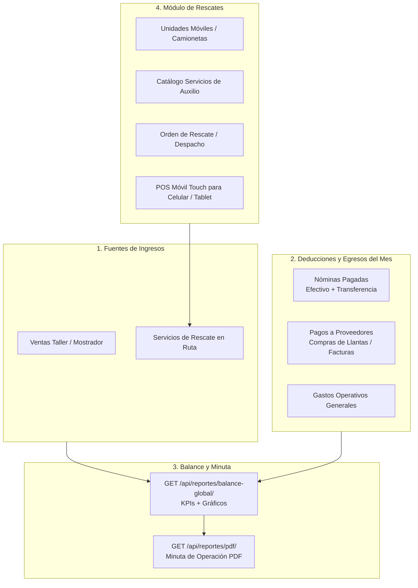

# 📐 Especificación Técnica de Diseño: Balance Global, Minuta y Módulo de Rescates

**Fecha:** 2026-10-06  
**Autores:** Orquestador (Tech Lead) & Arquitecto de Software  
**Proyecto:** Sistema de Gestión - Centro Llantero EmirS  

---

## 1. 🎯 Objetivos de la Intervención

1. **Balance Financiero Global del Mes:**
   - Consolidar en un solo balance todos los ingresos cobrados (Ventas de mostrador + Servicios de rescate en ruta).
   - Deducir de forma transparente los egresos reales:
     - **Nóminas pagadas** (sueldos netos, comisiones y domingos pagados en efectivo y transferencia).
     - **Pagos a Proveedores** (abonos a facturas y compras de lotes de llantas/mercancía).
     - **Gastos Operativos generales** (renta, luz, insumos, gasolina, etc.).
   - Calcular tanto el **Flujo de Caja Real** (dinero en mano / bancos) como la **Utilidad Operativa**.

2. **Actualización del Reporte Minuta:**
   - Incorporar en la **Minuta de Operación PDF** el desglose de pagos a proveedores y nóminas pagadas, garantizando una fotografía ejecutiva completa del negocio.

3. **Nuevo Módulo de "Rescates" (Auxilio Vial / Rescate Llantero):**
   - App independiente con su propio catálogo de servicios viales (cambio de llanta, parche vulcanizado en ruta, paso de corriente, rescate en autopista, etc.) y venta de llantas nuevas/usadas en ruta.
   - **POS Móvil Independiente:** Diseñado exclusivamente para celulares y tablets (diseño *touch-first*, botones ergonómicos grandes para operador de campo, enlace directo a Google Maps/Waze, cobro con efectivo, tarjeta débito/crédito, transferencia, ticket térmico y botón para enviar ticket al cliente por WhatsApp).

---

## 2. 🏗️ Arquitectura del Sistema

---

## 3. ⚙️ Especificación de Backend

### A. Módulo de Reportes y Minuta (`backend/apps/reportes/`)

1. **Nuevo Endpoint de Balance Global (`BalanceGlobalView`):**
   - **Ruta:** `GET /api/reportes/balance-global/`
   - **Parámetros:** `fecha_inicio`, `fecha_fin`, `mes`, `anio`.
   - **Lógica de Consolidación:**
     - `ingresos_taller`: Suma de `Venta` en el rango.
     - `ingresos_rescates`: Suma de `Rescate` completados.
     - `desglose_ingresos`: Efectivo, Débito, Crédito, Transferencia.
     - `egresos_nomina`: Suma de `PeriodoNomina` con `estado='pagada'` cuya `fecha_fin` caiga en el rango (`total_efectivo` + `total_transferencia`).
     - `egresos_proveedores`: Suma de `PagoProveedor` en el rango de fechas.
     - `egresos_gastos`: Suma de `Gasto` en el rango.
     - `flujo_neto_mes = (total_ingresos) - (egresos_nomina + egresos_proveedores + egresos_gastos)`.
     - `utilidad_operativa = (total_ingresos) - (costo_mercancia_vendida + egresos_nomina + egresos_gastos)`.

2. **Actualización de Minuta de Operación PDF (`ReportePDF`):**
   - Agregar sección ejecutiva **"PAGOS A PROVEEDORES Y COMPRAS"**.
   - Agregar sección ejecutiva **"NÓMINAS Y PERSONAL"** (desglosando sueldos, comisiones y domingos).
   - Tabla comparativa de **Balance Financiero del Período**.

---

### B. Nueva App de Rescates (`backend/apps/rescates/`)

1. **Modelos:**
   - `UnidadMovil`: Número económico (`UNIDAD-01`), nombre, placas, chofer habitual (`Empleado`), activo.
   - `TipoServicioRescate`: Nombre (`Parche en Carretera`, `Cambio de Llanta`, `Paso de Corriente`), precio base, comisión sugerida chofer, activo.
   - `Rescate`: Folio (`RES-00001`), fecha, estado (`solicitado`, `en_camino`, `en_proceso`, `completado`, `cancelado`), unidad (`UnidadMovil`), operador (`Empleado`), cliente (`Cliente`), nombre cliente, teléfono, dirección/ubicación texto, coordenadas GPS, vehículo atendido (marca/modelo/placas/medida llanta), método de pago (`efectivo`, `tarjeta`, `transferencia`, `mixto`), `tipo_tarjeta` (`debito`, `credito`), montos, subtotal, descuento, total.
   - `DetalleRescate`: Servicio de rescate y/o Producto (llanta/refacción) con descuento de inventario automático (`SalidaInventario`).

2. **Endpoints:**
   - `GET/POST /api/rescates/unidades/` (CRUD Unidades)
   - `GET/POST /api/rescates/tipos-servicios/` (CRUD Servicios de Auxilio)
   - `GET/POST /api/rescates/` (Listado y creación de rescates)
   - `POST /api/rescates/{id}/cambiar-estado/` (Flujo operativo)
   - `POST /api/rescates/{id}/cobrar/` (Cobro POS móvil con folios y vouchers)
   - `GET /api/rescates/{id}/ticket/` (Datos estructurados para ticket móvil e impresión)

---

## 4. 🎨 Especificación de Frontend

### A. Reportes y Balance Global ([Reportes.jsx](file:///c:/Users/chewb/OneDrive/Documentos/sistema-de-gestion-emirs/frontend/src/pages/reportes/Reportes.jsx))
- Nueva pestaña **"Balance Financiero Global"**:
  - Selector de mes/año con selector de rango personalizado.
  - KPI Cards en grid responsivo:
    - 🟢 **Ingresos Totales** (Taller + Rescates).
    - 🔴 **Nóminas Pagadas** (Total neto + comisiones).
    - 🟠 **Pagos a Proveedores** (Abonos a compras).
    - 🟣 **Gastos Operativos**.
    - 💰 **Flujo Neto del Mes**.
  - Gráfico interactivo de distribución de egresos y comparativa semanal.
  - Botón de descarga de la **Minuta de Operación PDF Completa**.

### B. Módulo de Rescates en Ruta ([Rescates.jsx](file:///c:/Users/chewb/OneDrive/Documentos/sistema-de-gestion-emirs/frontend/src/pages/rescates/Rescates.jsx))
- **Panel de Control de Despacho:**
  - Pestañas: *Rescates Activos*, *Nuevo Rescate / Despacho*, *Historial*, *Catálogo de Servicios*, *Unidades Móviles*.
  - Vista de tarjetas Kanban táctiles para celular y tablet:
    - 🚨 *Solicitados* -> 🚗 *En Camino* -> 🔧 *En Proceso* -> 🏁 *Por Cobrar*.
  - Botón "Abrir en Waze / Google Maps" que utiliza las coordenadas GPS o dirección capturada.
- **POS Móvil de Rescates (`POSRescate.jsx`):**
  - Diseñado con ergonomía táctil optimizada para celular (pantallas de 360px a 430px) y tablets:
    - Botones de acción principal grandes (`min-h-[52px]` o `60px`).
    - Grid táctil para seleccionar servicios rápidos (con 1 toque).
    - Selector táctil de método de pago (Efectivo / Tarjeta Débito / Tarjeta Crédito / Transferencia).
    - Teclado numérico en pantalla con cálculo instantáneo de cambio.
    - Modal de Ticket de Rescate con:
      - 🖨️ Impresión térmica 58mm Bluetooth.
      - 📲 **Botón "Compartir Ticket por WhatsApp"** (genera enlace `https://wa.me/?text=...` con el detalle de servicio, fecha, unidad y total).

---

## 5. 🧪 Plan de Verificación

1. **Backend Tests:**
   - Pruebas unitarias de cálculo de balance deduciendo nóminas y proveedores.
   - Pruebas unitarias de flujo completo de rescate (creación -> en camino -> cobro POS móvil -> salida de inventario).
2. **Frontend Linter & Responsiveness:**
   - Verificación de viewport móvil (375px, 414px, 768px, 1024px).
   - `npm run build` sin errores.
3. **Auditoría de Seguridad:**
   - Permisos RBAC en rescates y balance financiero.
