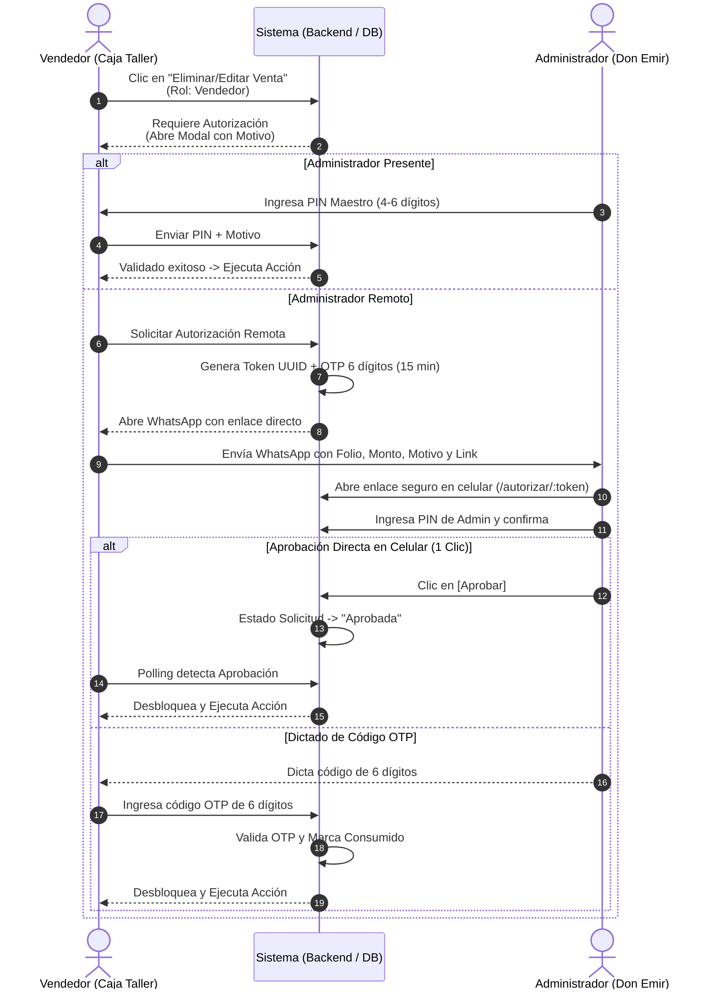
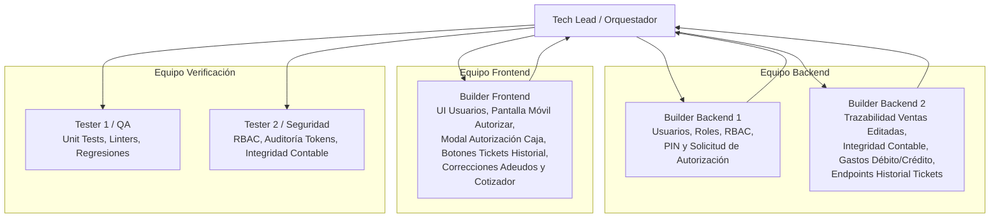

# Especificación de Diseño: Usuarios, Control de Acceso (RBAC), Autorización Remota por WhatsApp, Trazabilidad Contable y Mejoras del Sistema

**Fecha:** 2026-10-28  
**Autor:** Tech Lead / Equipo de Arquitectura y Agentes  
**Proyecto:** Sistema de Gestión - Centro Llantero EmirS  
**Estado:** Aprobado para Implementación  

---

## 1. Visión General del Proyecto

Este documento establece la arquitectura, modelos de datos, flujos de usuario, endpoints y contratos de interfaz para implementar:
1. **Módulo de Gestión de Usuarios y Roles (RBAC):** Creación visual de cuentas, gestión de contraseñas y asignación de roles (`admin` y `vendedor`).
2. **Control de Acceso Estricto (Niveles):**
   - `admin`: Acceso irrestricto a todos los módulos y operaciones.
   - `vendedor`: Bloqueo total al módulo de **Nómina** y restricción en Caja para no editar/eliminar ventas sin autorización.
3. **Flujo Híbrido de Autorización de Ventas (Local + WhatsApp Remoto):**
   - Autorización presencial con **PIN Maestro**.
   - Autorización remota mediante **token de 15 min y enlace directo a WhatsApp** con pantalla móvil de aprobación en 1 clic o código OTP de 6 dígitos.
4. **Trazabilidad de Ventas Editadas e Integridad Contable Automática:**
   - Indicador visual `[EDITADA]` con metadata (quién, cuándo, motivo, quién autorizó, total anterior).
   - Recálculo contable automático inmediato: ajuste de saldo esperado en caja activa, egresos/ingresos en balances y reversión o ajuste estricto de inventario (`SalidaInventario`).
5. **Cajas Pasadas (Historial):** Consulta de detalle y reimpresión de tickets térmicos de ventas en cajas cerradas.
6. **Correcciones de UI y Estabilidad:**
   - Corrección de colores oscuros en la barra de pagos registrados en Adeudos (`Adeudos.jsx`).
   - Métodos de pago en Gastos: separación de `tarjeta_debito` y `tarjeta_credito`.
   - Solución definitiva al bug de colisión de caché de caja activa (`queryKey` en TanStack Query).
   - Limpieza en Cotizador: eliminar checkbox duplicado de MSI y suprimir distinción de gamas (económica, media, premium) dejando selector único de llanta.
   - Sondeo en tiempo real e invalidaciones instantáneas en Rescates en Ruta.
7. **Organización del Equipo de Agentes:** Incorporación de `builder-backend-2` para desarrollo backend concurrente.

---

## 2. Arquitectura de Datos y Modelos (Backend)

### 2.1. Modelo `Usuario` y PIN de Autorización (`apps/usuarios/models.py`)
```python
class Usuario(AbstractUser):
    ROLES = [
        ('admin', 'Administrador'),
        ('vendedor', 'Vendedor'),
    ]
    rol = models.CharField(max_length=20, choices=ROLES, default='vendedor')
    telefono = models.CharField(max_length=20, blank=True)
    pin_seguridad = models.CharField(
        max_length=128, blank=True, null=True,
        help_text="Hash del PIN numérico de 4 a 6 dígitos para autorizaciones rápidas"
    )
    activo = models.BooleanField(default=True)
    fecha_ultimo_acceso = models.DateTimeField(null=True, blank=True)
```
- Métodos auxiliares: `set_pin(raw_pin)`, `check_pin(raw_pin)`.

### 2.2. Modelo `SolicitudAutorizacion` (`apps/ventas/models.py` o `apps/caja/models.py`)
```python
class SolicitudAutorizacion(models.Model):
    ACCIONES = [
        ('eliminar_venta', 'Eliminar Venta'),
        ('editar_venta', 'Editar Venta'),
    ]
    ESTADOS = [
        ('pendiente', 'Pendiente'),
        ('aprobada', 'Aprobada'),
        ('rechazada', 'Rechazada'),
        ('expirada', 'Expirada'),
        ('consumida', 'Consumida / Aplicada'),
    ]
    token = models.UUIDField(default=uuid.uuid4, unique=True, editable=False)
    codigo_otp = models.CharField(max_length=6, help_text="Código numérico de 6 dígitos")
    accion = models.CharField(max_length=30, choices=ACCIONES)
    venta = models.ForeignKey('ventas.Venta', on_delete=models.CASCADE, related_name='solicitudes_autorizacion')
    solicitado_por = models.ForeignKey('usuarios.Usuario', on_delete=models.CASCADE, related_name='solicitudes_creadas')
    autorizado_por = models.ForeignKey('usuarios.Usuario', on_delete=models.SET_NULL, null=True, blank=True, related_name='solicitudes_autorizadas')
    motivo = models.TextField(help_text="Motivo obligatorio ingresado por el vendedor")
    estado = models.CharField(max_length=20, choices=ESTADOS, default='pendiente')
    created_at = models.DateTimeField(auto_now_add=True)
    expires_at = models.DateTimeField()
    ip_solicitud = models.GenericIPAddressField(null=True, blank=True)
```

### 2.3. Trazabilidad en Modelo `Venta` (`apps/ventas/models.py`)
Campos nuevos para trazabilidad e impacto contable:
```python
fue_editada = models.BooleanField(default=False)
fecha_edicion = models.DateTimeField(null=True, blank=True)
editada_por = models.ForeignKey('usuarios.Usuario', on_delete=models.SET_NULL, null=True, blank=True, related_name='ventas_editadas')
motivo_edicion = models.TextField(blank=True, default='')
autorizada_por = models.ForeignKey('usuarios.Usuario', on_delete=models.SET_NULL, null=True, blank=True, related_name='ventas_autorizadas')
total_original = models.DecimalField(max_digits=10, decimal_places=2, null=True, blank=True)
diferencia_monetaria = models.DecimalField(max_digits=10, decimal_places=2, default=Decimal('0.00'))
```

### 2.4. Modelo `Gasto` (`apps/gastos/models.py`)
Actualizar `METODOS_PAGO`:
```python
METODOS_PAGO = [
    ('efectivo', 'Efectivo'),
    ('transferencia', 'Transferencia'),
    ('tarjeta_debito', 'Tarjeta de Débito'),
    ('tarjeta_credito', 'Tarjeta de Crédito'),
    ('tarjeta', 'Tarjeta (General)'), # Compatibilidad legado
]
```

---

## 3. Lógica Contable y Transaccional (Integridad de Caja e Inventario)

### 3.1. Eliminación de Ventas
- **Transacción Atómica (`transaction.atomic`):**
  1. Verificar que la venta pertenezca a una caja abierta (o requerir autorización de admin).
  2. Revertir todas las salidas de inventario (`SalidaInventario` de la venta): devolver el `stock_actual` a los productos.
  3. Descontar el importe de la venta de los acumuladores de la caja (`total_ventas`, `total_ventas_efectivo`, `total_ventas_tarjeta`, `saldo_esperado`).
  4. Registrar en `LogAuditoria` la eliminación con el usuario que ejecutó y quién autorizó.
  5. Eliminar la venta y sus detalles de la base de datos (o borrado suave si aplica).

### 3.2. Edición de Ventas
- **Transacción Atómica (`transaction.atomic`):**
  1. Comparar detalles anteriores vs nuevos detalles:
     - Si aumentó cantidad de un producto: verificar stock disponible y generar salida adicional.
     - Si disminuyó o quitó producto: reintegrar la diferencia al stock.
  2. Calcular `nuevo_total` vs `total_anterior`:
     - `diferencia = nuevo_total - total_anterior`.
     - Si `diferencia != 0`:
       - Impactar directamente el saldo de la caja según el método de pago:
         * Si efectivo: `caja.total_ventas_efectivo += diferencia`.
         * Si tarjeta: `caja.total_ventas_tarjeta += diferencia`.
         * `caja.total_ventas += diferencia`.
         * `caja.save()`.
  3. Actualizar campos de auditoría: `fue_editada = True`, `fecha_edicion = timezone.now()`, `total_original = total_original or total_anterior`, `diferencia_monetaria = diferencia`.

---

## 4. Flujo de Autorización Local y Remota (WhatsApp)



---

## 5. Diseño de Componentes de Frontend

### 5.1. Módulo "Usuarios y Roles" (`frontend/src/pages/usuarios/Usuarios.jsx`)
- Accesible únicamente por usuarios con `rol === 'admin'`.
- Tabla de usuarios con: Nombre, Username, Teléfono, Rol (`Administrador` / `Vendedor`), Estado (`Activo` / `Inactivo`), Último acceso.
- Botones de acción: "Nuevo Usuario", "Editar", "Cambiar Rol", "Restablecer Contraseña / PIN", "Desactivar".

### 5.2. Control de Rutas y Menú Lateral (`MainLayout.jsx` y `App.jsx`)
- En `NAV_SECTIONS` de `MainLayout.jsx`:
  - Ocultar la sección o enlace de **Nómina** (`/nomina`) si `user.rol !== 'admin'`.
  - Agregar enlace de **Usuarios** (`/usuarios`) bajo la categoría *Sistema*, visible únicamente si `user.rol === 'admin'`.
- En `App.jsx`: Crear componente de protección `AdminRoute` para que si un vendedor intenta navegar directamente por URL a `/nomina` o `/usuarios`, sea redirigido con mensaje de acceso restringido.

### 5.3. Pantalla de Autorización Móvil (`frontend/src/pages/autorizar/AutorizarSolicitud.jsx`)
- Ruta pública accesible vía token: `/autorizar/:token`.
- Diseño móvil limpio, tema oscuro institucional de EmirS:
  - Tarjeta de la venta: Folio, Monto, Vendedor, Motivo, Tiempo restante (cuenta regresiva de 15 min).
  - Teclado o input para PIN de Administrador (4 dígitos).
  - Dos botones de acción: **[APROBAR ACCIÓN EN CAJA]** (Verde) y **[RECHAZAR]** (Rojo).
  - Recuadro destacado con el **Código OTP de 6 dígitos**.

### 5.4. Caja Pasadas (Historial) (`frontend/src/pages/caja/Caja.jsx`)
- En la tabla de ventas de cajas cerradas dentro de `Historial`:
  - Agregar columna **Acciones** a la derecha:
    * Botón **"Ver"** (ícono `EyeIcon` / `ri-eye-line`): abre modal con desglose de la venta.
    * Botón **"Ticket"** (ícono `PrinterIcon` / `ri-printer-line`): abre `ModalTicket` con la venta para reimprimir el ticket térmico formal.

### 5.5. Corrección de Color en Adeudos (`Adeudos.jsx`)
- En línea 424 de `frontend/src/pages/inventario/Adeudos.jsx`:
  - Cambiar `bg-gray-50/80 border border-gray-200` por `bg-[#161a29] border border-white/[0.08]`.
  - Cambiar las 5 sub-tarjetas internas `bg-white border-gray-100` por `bg-[#1b2032] border border-white/[0.05]`.
  - Actualizar títulos a `text-slate-400` y montos a `text-white font-bold`.

### 5.6. Limpieza en Cotizador (`TabCotizador.jsx`)
- Eliminar el bloque de checkbox duplicado en líneas 974-990.
- Reemplazar los 3 botones de `+ Opción Económica`, `+ Opción Gama Media`, `+ Opción Premium` por un solo botón primario: **`+ Agregar Llanta / Opción`**.
- Eliminar selectores de gama (`op.gama`) del formulario, texto de WhatsApp y plantilla PDF.

### 5.7. Solución del Bug de Caché en Caja Activa
- En `frontend/src/pages/caja/Caja.jsx`: cambiar `queryKey: ['caja-activa']` a `queryKey: ['caja-activa-completa']`.
- En `frontend/src/pages/ventas/Ventas.jsx`: mantener `queryKey: ['caja-activa-pos']`.
- Cuando se abra o cierre una caja, invalidar ambas claves para sincronización total.

---

## 6. Asignación de Tareas por Agentes



---

## 7. Plan de Verificación y Criterios de Éxito

1. **Gestión de Usuarios:** El Administrador puede crear un usuario `vendedor`, definir su contraseña y verificar que pueda iniciar sesión.
2. **Restricción de Rol:** Un usuario con rol `vendedor` no puede ver la ruta `/nomina` en el menú ni acceder por endpoint (retorna 403 Forbidden).
3. **Autorización Local y Remota:**
   - Si el vendedor intenta borrar o editar una venta, el sistema exige autorización.
   - El PIN maestro de admin autoriza de inmediato.
   - La opción de WhatsApp genera el mensaje con enlace seguro a `/autorizar/:token` y expira en 15 minutos.
   - El admin puede autorizar en 1 clic desde el celular o dictar el OTP de 6 dígitos.
4. **Trazabilidad y Contabilidad:**
   - La venta editada muestra el badge `[EDITADA]`.
   - La diferencia monetaria se refleja inmediatamente en el saldo esperado de la caja y en los totales del balance.
   - Si se elimina, el dinero se descuenta de los ingresos y el stock de llantas se reintegra.
5. **Cajas Pasadas:** En el historial de cajas cerradas, se puede reimprimir el ticket de cualquier venta.
6. **UI y Bugs:**
   - El recuadro de subtotales en Adeudos se integra al 100% con el tema oscuro.
   - Se elimina el bug de caja activa que se cerraba al cambiar de módulo.
   - En cotizaciones se elimina el checkbox duplicado y la distinción de gamas.
   - En gastos se puede registrar con Tarjeta de Débito o Tarjeta de Crédito.
7. **Calidad de Código:** `python manage.py test` 100% pasando y `npm run lint` con 0 errores y 0 warnings.
