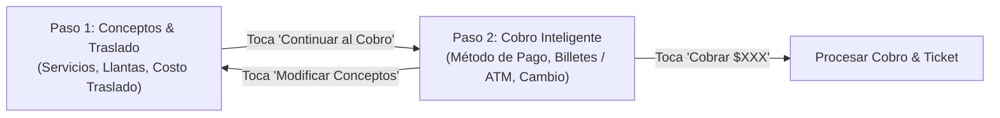

# 📱 Especificación de Diseño: Cobro Ergonómico en Rescates (POS Técnico de Campo)

**Fecha:** 29 de Octubre de 2026  
**Proyecto:** Sistema de Gestión - Centro Llantero EmirS  
**Módulo:** Rescates en Ruta / Punto de Venta Móvil (`POSRescateModal.jsx`)  
**Estado:** Propuesta de Diseño para Aprobación  

---

## 1. 🎯 Diagnóstico y Objetivo del Negocio

En los rescates viales, los técnicos operan directamente desde sus teléfonos móviles o tabletas en condiciones de campo (bajo el sol, en el tráfico, a menudo con guantes de trabajo o manos sucias). La calculadora y flujo de cobro actual presentaban fricciones:
- Teclado numérico no estándar de 4 columnas con teclas de control (`⌫`, `C`) en posiciones extrañas.
- Desconexión visual entre el teclado y el monto ingresado, obligando a realizar scroll vertical en móviles.
- Ineficiencia al cobrar en efectivo: el 90% de los clientes pagan con **monto exacto** o con billetes de **$200, $500 o $1,000**, por lo que teclear dígito por dígito resultaba lento e innecesario.
- Al cobrar con **Tarjeta (Débito/Crédito) o Transferencia**, el teclado numérico seguía visible restando espacio vital en pantalla.

**Objetivo:** Rediseñar la experiencia de cobro en [`POSRescateModal.jsx`](file:///c:/Users/chewb/OneDrive/Documentos/sistema-de-gestion-emirs/frontend/src/pages/rescates/POSRescateModal.jsx) implementando un **flujo ergonómico en 2 pasos** enfocado en velocidad táctil, billetes comunes de un solo toque, teclado cajero estándar (3x4) con display digital integrado, y ocultamiento inteligente del teclado cuando no se use efectivo.

---

## 2. 🪜 Flujo Ergonómico en 2 Pasos

### 🔹 Paso 1: "Conceptos & Desplazamiento"
- **Propósito:** El técnico revisa o agrega los servicios realizados (parche, desmonte, etc.), llantas/cámaras utilizadas y el costo de traslado.
- **Catálogo Rápido:**
  - Selector táctil de **Servicios de Auxilio** vs **Llantas & Insumos**.
  - Tarjetas grandes con precio y botón de agregar.
  - Buscador inteligente con detección automática de medidas.
- **Lista de Conceptos a Cobrar:**
  - Stepper táctil (+ / -) para modificar cantidades rápidamente o eliminar items.
- **Costo de Traslado / Desplazamiento:**
  - Presets de un solo toque: `[$0]`, `[+$150]`, `[+$250]`, `[+$350]`, `[+$500]` o campo directo.
- **Botón de Avance Primario:**
  - Barra inferior fija: `[ Continuar al Cobro: $XXX MXN ➔ ]` (verde / rojo de alto impacto).

---

### 🔹 Paso 2: "Cobro & Cambio"
- **Propósito:** Registrar el pago del cliente de la manera más rápida posible con cero margen de error en el cambio.
- **Cabecera de Resumen:**
  - Muestra Total a Cobrar destacado en texto grande y legible: **`$XXX.00 MXN`**.
  - Enlace rápido: `[ ‹ Modificar Conceptos ]` para regresar al Paso 1 si faltó algún servicio.
- **Selector de Método de Pago:**
  - Botones táctiles grandes con Remix Icons:
    * `[ 💵 Efectivo ]` (con ícono `ri-money-dollar-circle-line`)
    * `[ 💳 Débito ]` (con ícono `ri-bank-card-line`)
    * `[ 💳 Crédito ]` (con ícono `ri-bank-card-2-line`)
    * `[ 🏦 Transferencia ]` (con ícono `ri-bank-line`)
    * `[ 🔀 Mixto ]` (con ícono `ri-shuffle-line`)

---

## 3. 💵 Experiencia al Cobrar en Efectivo: Billetes Rápidos y Teclado Cajero (ATM)

### A. Botones de Billetes Rápidos (1 Solo Toque)
Al seleccionar **Efectivo**, en la parte superior se despliega una fila de botones de billetes preconfigurados:
- `[ Cobro Exacto ]`: Fija el monto recibido exactamente igual al total ($0 cambio).
- `[ $200 ]`, `[ $500 ]`, `[ $1,000 ]`: Si el total es menor a la denominación, calcula el cambio al instante.
- `[ +$100 ]`, `[ +$200 ]`, `[ +$500 ]`: Para sumar billetes acumulativos (ej. si pagan con dos de $200).

### B. Display Digital "Caja Registradora" (Alto Contraste)
Justo encima del teclado o en la tarjeta de efectivo:
- **Total a Pagar:** `$450.00`
- **Monto Recibido:** `$500.00` (editable con teclado)
- **Cambio a Devolver:** **`$50.00`** (en badge grande verde esmeralda brillante `#10b981`, con texto en negrita, visible a metros de distancia en exteriores).
- *Alerta de monto insuficiente:* Si el dinero recibido es menor al total, el badge cambia a advertencia ámbar/roja indicando claramente: *«Faltan $XX.00»* y desactiva el botón de cobrar hasta completar el importe.

### C. Teclado Numérico Estándar Cajero (ATM 3x4)
Diseño ergonómico estándar de calculadora / POS (botones con altura táctil mínima de 50px y espaciado generoso para dedos de mecánico):

| Col 1 | Col 2 | Col 3 |
| :---: | :---: | :---: |
| **1** | **2** | **3** |
| **4** | **5** | **6** |
| **7** | **8** | **9** |
| **C** (Borrar todo) | **0** | **⌫** (Retroceso con `ri-delete-back-2-line`) |

*Nota:* Opcional fila inferior para `.` (punto decimal) y `00`.

---

## 4. 💳 Experiencia en Tarjeta, Transferencia y Mixto

- **Tarjeta Débito / Crédito:**
  - El teclado numérico y los billetes se **ocultan completamente**.
  - Muestra mensaje limpio: *«Cobro total por $XXX.00 en terminal bancaria»*.
  - Campo opcional: *«Núm. de autorización / terminal»*.
- **Transferencia:**
  - Oculta el teclado numérico.
  - Muestra datos bancarios institucionales rápidos (Santander Emir Rosado) por si el cliente necesita el número de cuenta o CLABE para transferir en el momento.
  - Campo de texto: *«Clave de rastreo o referencia»*.
- **Mixto:**
  - Permite ingresar la parte en Efectivo y calcula automáticamente el remanente con tarjeta o transferencia.

---

## 5. 🎨 Directrices Estéticas y Accesibilidad (Reglas de Oro)
- **CERO Emojis:** Todos los íconos del modal usan exclusivamente la biblioteca oficial **Remix Icon (`ri-...`)**:
  - `ri-money-dollar-circle-line`, `ri-bank-card-line`, `ri-bank-line`, `ri-shuffle-line`, `ri-delete-back-2-line`, `ri-check-line`, `ri-close-line`, `ri-arrow-right-line`, `ri-arrow-left-line`.
- **Tema Oscuro de Alto Contraste:**
  - Fondos `#0f172a`, `#1e293b`, bordes definidos `#334155`.
  - Textos de importes en tipografía monospace (`font-mono`) en verde esmeralda `#34d399` y rojo de acento `#df000a`.
- **Botón de Cobro Gigante Fijo:**
  - Ancho completo, altura de 56px, siempre visible sin necesidad de scroll en móviles pequeños.

---

## 6. 🧪 Plan de Verificación
1. **Verificación de Cálculos:** Probar casos de pago exacto, pago con billete mayor (cálculo de cambio) y pago insuficiente.
2. **Pruebas de Transición de Pasos:** Confirmar que al cambiar entre Paso 1 y Paso 2 no se pierdan los items ni el costo de traslado capturado.
3. **Compatibilidad con Backend:** El payload enviado a `onProcesarCobro` mantiene intacta la estructura esperada por `apps/rescates/views.py`.
4. **Linters & Build:** `npm run lint` y `npm run build` limpios al 100%.
